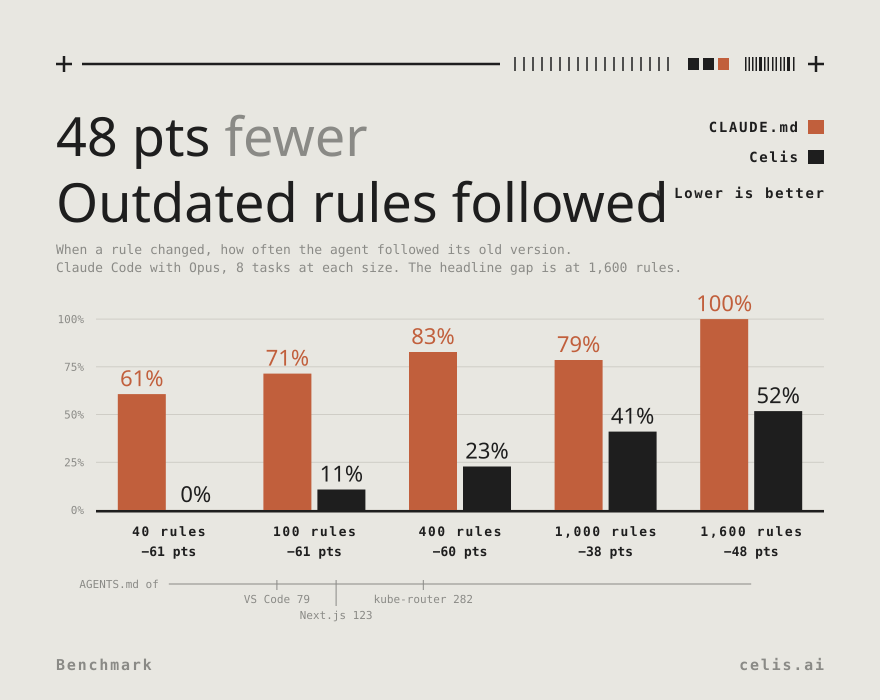
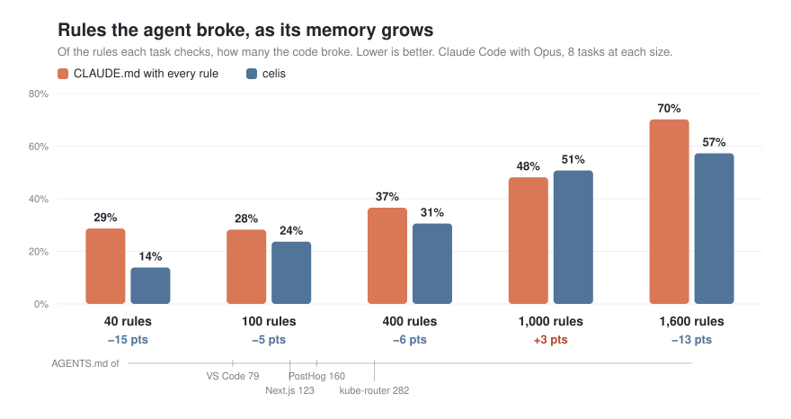

<h1 align="center">Celis</h1>

<h3 align="center">Stop babysitting your coding agent</h3>

<p align="center">Celis keeps your rules and gives your agent the discipline to follow them, in every project
and every agent.</p>

<p align="center">
  <a href="https://github.com/celishq/trails/releases/latest"></a>
  <a href="https://github.com/celishq/trails/actions/workflows/ci.yml"></a>
  <a href="LICENSE"></a>
</p>


https://github.com/user-attachments/assets/8cb59450-fb36-4fa6-82ae-5bcd59b1384b


## Why

- **Your agent follows through.** It gets the rule that matters right before it acts, not buried in a
  manual it read an hour ago. You stop catching the same mistake twice.
- **Correct it once.** A correction in chat or a code review becomes a rule that Celis keeps, in every
  project. On a new job, your agent also starts from similar work that went well.
- **Every agent keeps the same rules.** What you tell Claude Code, Codex and Cursor follow too.
- **You can check its work.** Every step comes with proof, like a passing test or a command's output, on
  a trail you can watch.

## How it works

A CLAUDE.md is a manual. Your agent reads it once at the start, and by the time it edits a file, the
one rule that matters is lost among hundreds of others. Celis is a checklist. It hands your agent the
few rules that apply right now: when a job starts, before it changes a file, and before it says it's
done.

Those rules come from your corrections and code reviews. Your agent works one step at a time, tries
the part it's least sure of first, proves each step works, and keeps what it learned as a rule. Each
step lands on a trail you can watch, so you see what your agent did and why.

```
Job: seniors pay 20% less
├─ ✓ Find where prices are set
├─ ⠏ Change how the price is worked out     ← not sure how yet, so it's split up
│  ├─ ✗ Change the price in the cart           dropped: the cart doesn't know the age
│  │                                           rule: set prices in prices.py, not the cart
│  ├─ ✓ Write a test: seniors pay 80%          proof: passes, once SHELF_OFFLINE=1 was set
│  │                                           rule: tests need SHELF_OFFLINE=1
│  └─ ○ Use the new price in prices.py      ← up next
└─ ○ Show the senior price on the page      ← will split this later

✓ done   ⠏ in progress   ○ to do   ✗ dropped
```

A week later, you ask for a student discount, and the agent starts with the senior discount's trail and
its two rules.

## Does it work?

We gave Claude Code 8 coding tasks with 40 to 1,600 rules to keep, taken from the agent files of big
open-source repos like VS Code and Next.js. We put the rules either in a CLAUDE.md or in Celis.





A small CLAUDE.md works well. As it grows, the agent misses more of its rules, and it often follows
the old version of a rule that changed. With Celis, the agent broke fewer rules at most sizes, and
followed old rules far less often. Real repos already have 80 to 280 rules in one agent file.

**Why?** The rules fit in the context window, but the agent's attention doesn't stretch that far. The
one rule that matters gets lost among hundreds of others. Celis gives the agent the right rules at
the right time: when a job starts, before it changes a file, and before it says it's done.

We treat the agent as a capable collaborator that owns its work. Celis doesn't tell it how to do the
job; it gives it what it needs to do the job well.

**It works across agents, too.** In another test, Claude Code learned the review rules of real
Supabase pull requests. Codex then broke 0.25 of them per job with Celis, against 2.38 without.

The full setup, numbers and limits are in [evals/drift](evals/drift/README.md).

## Install

**1. Install `celis`:**

```bash
curl -fsSL https://celis.ai/install.sh | sh
```

Or download the script first, read it, then run it:

```bash
curl -fsSLO https://celis.ai/install.sh
sh install.sh
```

To update it later, run `celis update`.

<details>
<summary>What the script does, and how to check the download</summary>

The script puts `celis` in `~/.local/bin`, with no `sudo`. When that folder isn't on your PATH, it
adds one `export PATH=…` line to `~/.profile` and to your shell's rc file.

Each archive on [GitHub Releases](https://github.com/celishq/trails/releases) has a checksum, which
the script checks, and a build attestation, which proves that this repo's release workflow built
it. To check an archive yourself with the [GitHub CLI](https://cli.github.com):

```bash
gh attestation verify celis-aarch64-apple-darwin.tar.gz -R celishq/trails
```

[SECURITY.md](SECURITY.md) says what Celis keeps, sends and runs.

</details>

**2. Add the plugin to your agent:**

| Agent       | Install                                                                         | Then                                                                                        |
| ----------- | ------------------------------------------------------------------------------- | ------------------------------------------------------------------------------------------- |
| Claude Code | `/plugin marketplace add celishq/trails`<br>`/plugin install celis@celis`       | —                                                                                           |
| Codex       | `codex plugin marketplace add celishq/trails`<br>`codex plugin add celis@celis` | Trust its hooks with `/hooks`. In a sandbox, let it write the folder Celis keeps trails in. |
| Cursor      | `cursor-agent plugin marketplace add https://github.com/celishq/trails`         | Install `celis` from `/plugins`. Cursor doesn't remind the agent on each message.           |
| Gemini CLI  | `gemini extensions install https://github.com/celishq/trails`                   | —                                                                                           |
| Antigravity | `agy plugin install https://github.com/celishq/trails`                          | Antigravity has no prompt hook, so Celis doesn't write your prompts on the trail.           |

**3. Give your agent a job,** and run `celis tree` in a second terminal to watch its steps.
Questions don't leave a trail; only jobs that change files do.

## Uninstall

1. Remove the plugin from your agent the same way you added it. In Claude Code, run
   `/plugin uninstall celis@celis`.
2. Delete the binary: `rm ~/.local/bin/celis`
3. To delete your trails and your key too, delete the data folder. This removes them for good:
   `~/Library/Application Support/Celis` on macOS, `~/.local/share/celis` on Linux.

## Questions

**How do I fix a bad rule?** Tell your agent. It writes a new rule that replaces the old one, and
agents stop seeing the old one.

**How do I share trails with my team?** Run `celis link` in the project. It keeps a copy of the
project's trails in `.celis/trails/`, so you can commit them. Rules you keep for all your own work
stay private.

**Where is my data?** On your machine only: `~/Library/Application Support/Celis` on macOS, and
`~/.local/share/celis` on Linux. Each record is a [nostr](https://nostr.org) note signed with your own
key, and Celis never sends it anywhere. To use another folder, set `CELIS_HOME` before you start the
agent. Run `celis auth phrase` to see your recovery phrase, and `celis auth login` on another
computer.

**Can agents find past work by meaning?** Run `celis setup` and choose a model. It downloads the model
from Hugging Face (0.5 to 1.2 GB) and indexes your trails on your machine. Then `celis search` finds rules
and past asks by meaning, in any language. With no model, agents search with `celis grep`.

**What else can I run?** `celis help` lists every command, such as `celis grep` to search your trails.

**Does it work on Windows?** Through WSL.

## Status

Celis is in early development: releases are `0.0.x`, and the trail format may still change. It works
with Claude Code, Codex, Cursor, Gemini CLI and Antigravity, on macOS and Linux.

We'd love to hear from you: [tell us here](https://tally.so/r/pbl09Z). To contribute, see
[CONTRIBUTING.md](CONTRIBUTING.md). Licensed under [MIT](LICENSE).
